# SummitRoad (macOS)

A SwiftUI indoor-cycling trainer app: smart-trainer ERG control, heart-rate monitors, FTP tests, an adaptive training plan, live coaching, scoring and Strava upload.

## Screenshots

All screenshots use demo data.

### The Mac app

| | |
|---|---|
| **Calendar**: planned workouts with a profile preview, completed rides with their score, and weekly hours/TSS | **Today**: your FTP and the next workout |
| 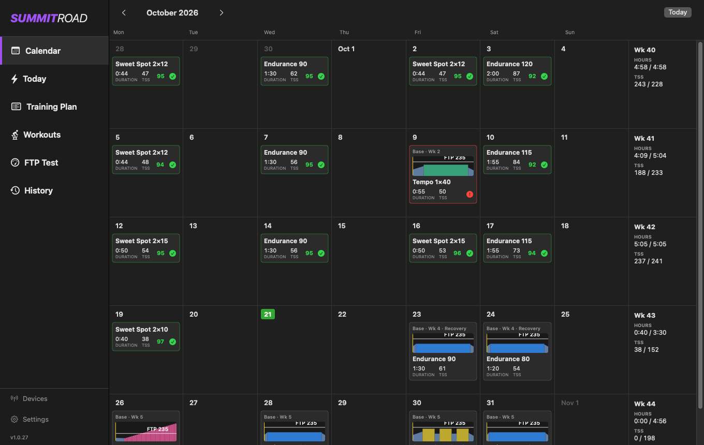 | 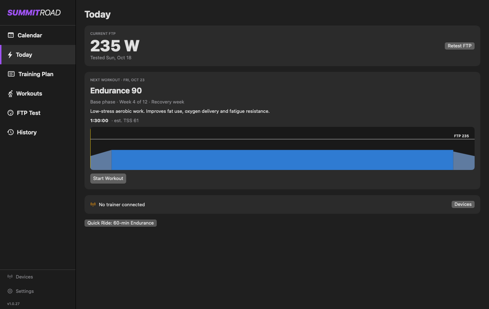 |
| **Training Plan**: Base, Build and Specialty weeks that adapt to how you ride | **Workouts**: ad-hoc workouts scaled to your FTP, with drills and an intensity override |
| 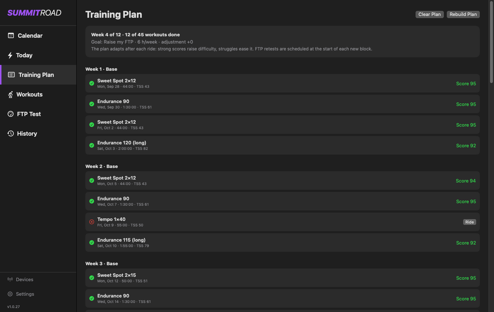 | 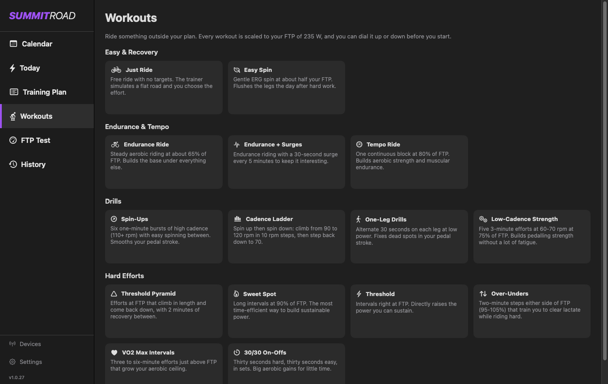 |

**The ride screen**: power, interval time and heart rate on top; target, workout time and cadence below; interval stats and the workout profile with your live trace.

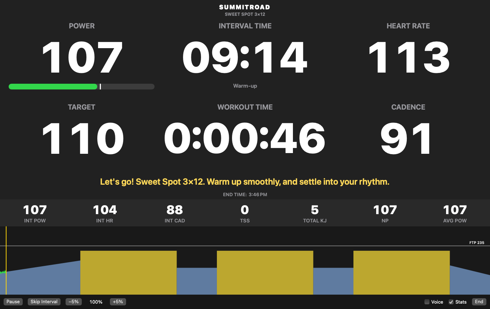

**Ride report**: training score, coach feedback and a chart you can hover for the values at each point; send the .FIT file to Strava or Garmin.

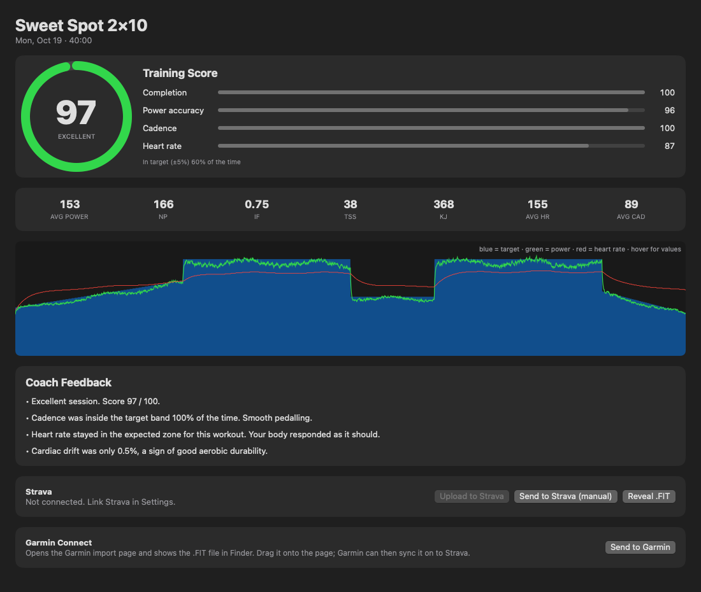

**Settings**: FTP, Strava, the optional home server, updates and data.

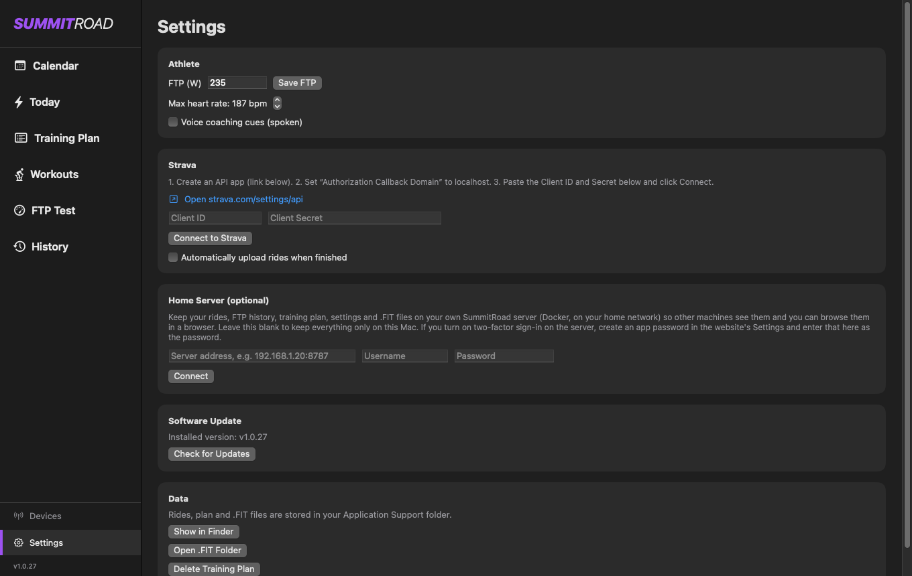

### The home server website (optional, see [server/README.md](server/README.md))

A small Docker container keeps your rides, FTP history, plan and settings on your own network, syncs them between your Macs and shows them in a browser.

| | |
|---|---|
| **Sign-in**, with optional two-factor | **Dashboard**: totals, FTP history, weekly TSS and every ride |
| 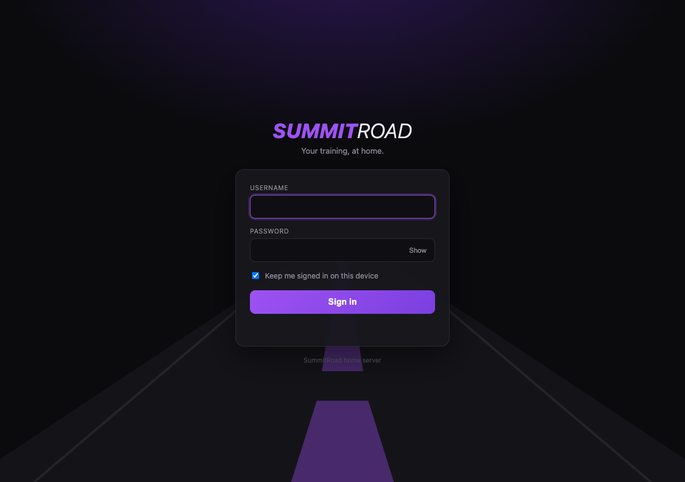 | 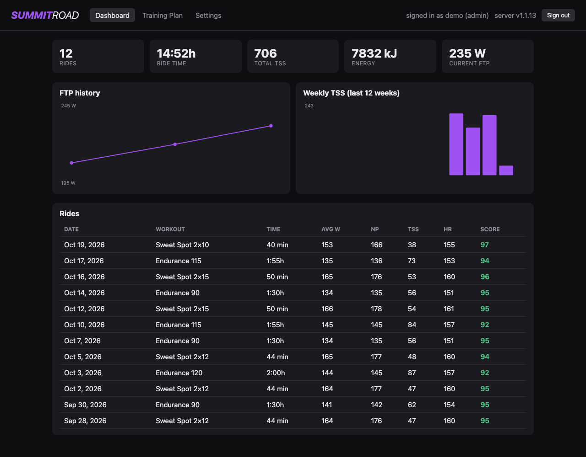 |

**Ride detail**: hover the chart for power, target, heart rate, cadence and speed.

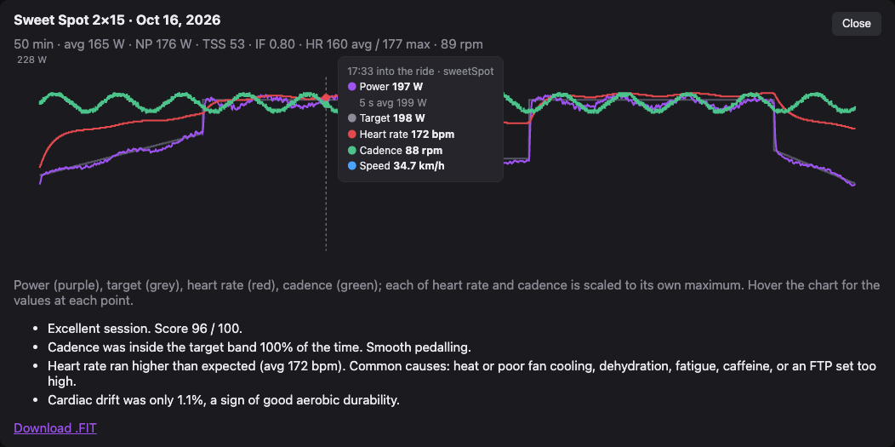

**Training plan** (read-only, from your Mac) with a version history you can restore from:

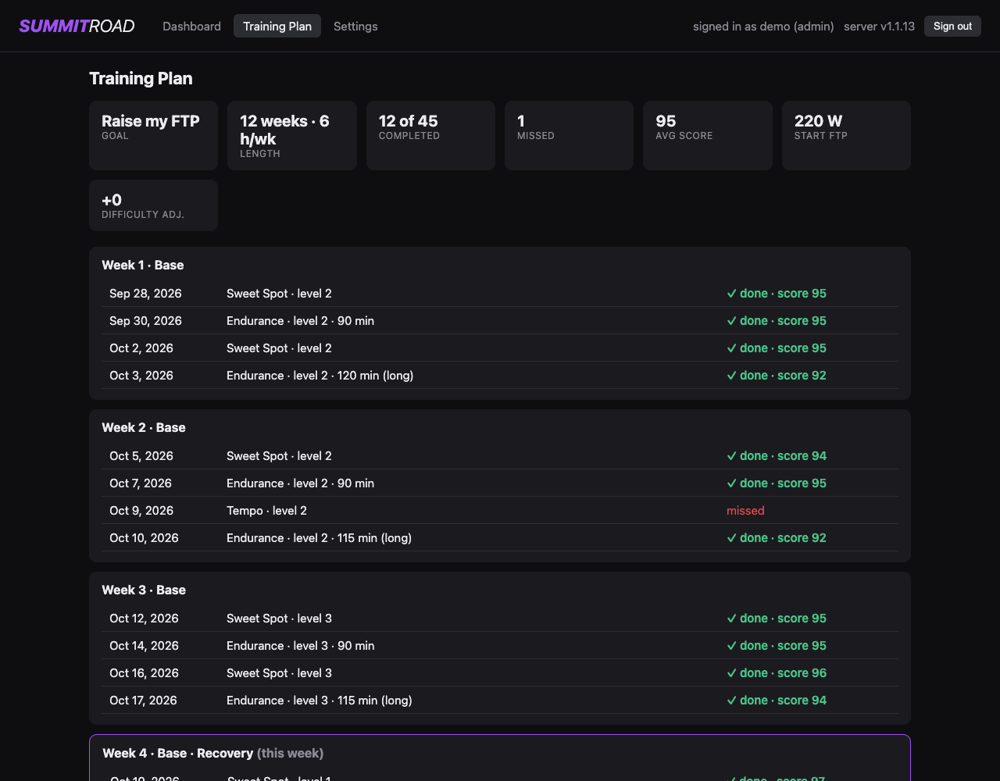

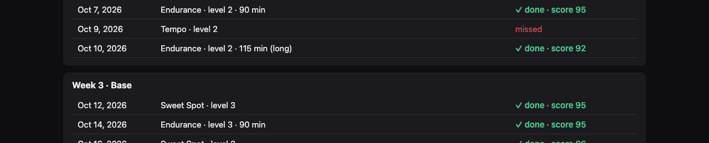

**Settings**: password, two-factor, app passwords for the Mac app, users (admin) and the activity log.

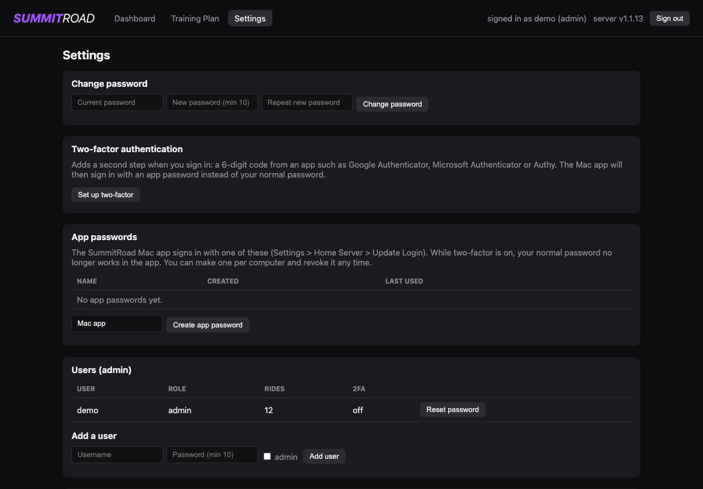

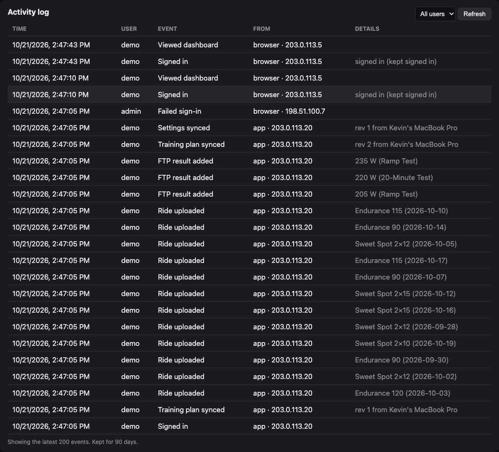

## Build & run

Requirements: macOS 13+, Xcode (or Xcode command-line tools).

```bash
cd SummitTrainer      # the project folder
chmod +x build_app.sh
./build_app.sh        # builds build/SummitRoad.app (and SummitRoad.zip) and opens it
```

Or open `Package.swift` in Xcode and press Run. If running from Xcode, Bluetooth permission is attached to Xcode's process; use `build_app.sh` for the packaged app (its Info.plist has the Bluetooth usage string).

## First ride

1. **Devices** > Scan. Elite Suito shows as "SUITO" (pedal to wake it; close Zwift/Elite apps first). Click **Use as Trainer**. Pair a Bluetooth HR strap with **Use as HR Monitor**. No hardware? Turn on **Demo mode**.
2. **FTP Test** > Ramp Test (about 20 min) or 20-Minute Test. FTP = 75% of best 1-min power (ramp) or 95% of the 20-min average. Click **Use This FTP** in the report.
3. **Training Plan** > Build Plan. Questions: goal, experience, hours/week, available days, longest ride, plan length, recovery/stress. You get an 8/10/12-week Base > Build > Specialty plan with a recovery week every 4th week and FTP retests at block starts and the final week (per the TrainerRoad article: assess every 4-6 weeks).
4. **Today** > Start Workout.

## Trainer support

- **FTMS smart trainers** (Elite Suito, Wahoo KICKR/Core, Tacx, Saris, JetBlack, most others): ERG target power, free-ride resistance.
- **Cycling Power devices** (power meters, basic power-only trainers): live power and cadence, no ERG. Match the targets manually.
- **Heart-rate**: any standard BLE HR strap/armband.

## Ride screen

Power / Interval time / Heart rate, Target / Workout time / Cadence, workout profile with your live power trace, interval stats (INT POW/HR/CAD, TSS, kJ, NP, AVG POW), coaching banner (interval starts, halfway, 1 min / 30 s / 10 s, 5-4-3-2-1 countdown, cadence and HR nudges, optional spoken cues). Space = pause. ±5% intensity, skip interval, end.

## Training score (0-100)

Completion 35%, power accuracy 35% (±5% of target = full marks), cadence in band 15%, HR in expected zone 15%. Missing sensors are left out and the weights are rescaled.

After each ride you get coach feedback (power vs target, fade, cadence, HR zone, cardiac drift) and a plan verdict: scores of 88+ raise upcoming difficulty, below 72 ease it, and repeated poor scores or very high scores recommend an FTP retest.

## Strava

1. strava.com/settings/api > create an app. Set **Authorization Callback Domain** to `localhost`.
2. Settings > paste Client ID and Secret > Connect to Strava (approve in the browser).
3. Rides are saved as `.FIT` and can be uploaded from the ride report, or automatically after each ride.

Data (profile, plan, rides, .FIT files) is in `~/Library/Application Support/SummitTrainer`.
